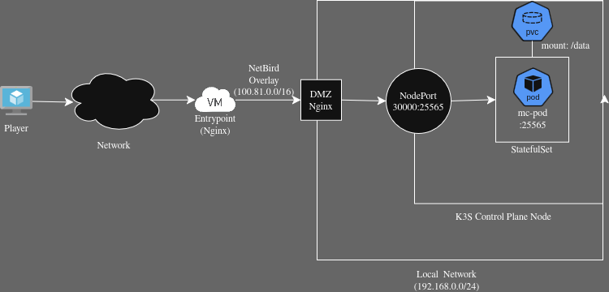

# minecraft-k3s-platform

Платформа для декларативного развертывания игровых серверов Minecraft в Kubernetes (k3s) с сквозной L4-маршрутизацией и автоматизированной публикацией OCI-артефактов в Harbor.

---

## 🏛 Архитектура решения

Сетевой периметр и контур доставки разделены на изолированные слои:



### Ключевые особенности:
* **L4-каскад проксирования:** трафик игрока поступает на внешний шлюз (Edge VPS), передается через шифрованный оверлей NetBird на локальный хост `DMZ Nginx` и перенаправляется на `NodePort` ноды k3s.
* **Симметричная маршрутизация:** `proxy_bind` на уровне DMZ Nginx гарантирует возврат пакетов через локальный шлюз без сброса соединений нодой k3s.
* **Изоляция хранилища:** StatefulSet монтирует независимый том PVC (`local-path`), сохраняющий данные мира при перезапусках подов.

---

## 📂 Структура репозитория

```text
.
├── .github/workflows/
│   ├── helm-ci.yaml               
│   └── helm-registry.yaml          # CI/CD воркфлоу сборки и проверки чартов
├── charts/
│   └── minecraft/            # Helm-чарт игрового сервера
│       ├── Chart.yaml
│       ├── values.yaml
│       └── templates/
│           ├── service.yaml
│           └── statefulset.yaml
├── infra/                    # Инфраструктура как код (Ansible)
│   ├── ansible.cfg
│   ├── deploy.yml            # Плейбук настройки пограничных шлюзов
│   ├── inventory/
│   │   └── hosts.yaml
│   ├── group_vars/all/       # Конфигурация и шифрованные vault-секреты
│   └── roles/
│       ├── bootstrap/        # Базовый сетап
│       ├── netbird/          # Конфигурация клиента оверлейной сети
│       └── dmz_nginx/        # Развертывание Stream Proxy с proxy_bind
└── README.md

```

🚀 CI/CD Пайплайн

В проекте используется GitHub Actions на базе self-hosted раннера с доверенным корневым сертификатом (Homelab Root CA).

    Ветка dev: выполняет helm lint charts/minecraft для валидации шаблонов без изменения реестра.

    Ветка main:

        Валидация синтаксиса чарта (helm lint).

        Авторизация в приватном OCI-реестре через --password-stdin.

        Сборка архива во временную директорию /tmp.

        Публикация версионированного OCI-артефакта в Harbor:
        Bash

        CHART_TAG=$(helm package charts/minecraft -d /tmp \vert{} awk '{print$NF}')
        helm push "$CHART_TAG" oci://192.168.0.211/helm-homelab
        rm -rf "$CHART_TAG"

🛠 Быстрый старт
Развертывание сетевого контура
Bash

cd infra/
ansible-playbook -i inventory/hosts.yaml deploy.yml --ask-vault-pass

Установка релиза из реестра Harbor
Bash

helm upgrade --install mc-survival oci://192.168.0.211/helm-homelab/minecraft \
  --version 0.1.0 \
  --namespace minecraft \
  --create-namespace \
  --set service.nodePort=30000